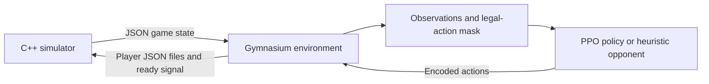

# Seven Wonders RL

A work-in-progress reinforcement-learning project for three-player **7 Wonders**. It adds a Python Gymnasium environment and PyTorch PPO agents to an existing C++ game simulator.

The simulator comes from [DMAG/UFSM's 7Wonders](https://github.com/dmag-ufsm/7Wonders). This project adds the RL environment, observation and action features, heuristic opponents, training/evaluation tools and snapshot self-play. It also includes a few targeted simulator fixes; it does not implement the original game engine from scratch.

**Status:** the environment, feature extraction and simulator regression tests work, but training remains experimental. A known multi-environment advantage-calculation issue needs correction before learning curves can be used as evidence of PPO performance. No validated trained agent or benchmark result is published here. See [known issues and development priorities](docs/KNOWN_ISSUES.md).

## How it works



Python starts the simulator, reads its state and submits actions for all three seats. The learner controls one seat; the other two use heuristic policies or frozen policy snapshots. Communication is currently file-based: `game_status.json`, `player_1.json` through `player_3.json`, and `ready.txt`.

The environment exposes 28 action slots: four action types for each of seven hand positions. These cover building a structure, building a wonder stage, using a free-build action and discarding. Masks restrict the available choices. Observation builders rotate player information relative to the learner and provide global state and per-action features. The terminal reward compares the learner's victory points with the strongest opponent, scaled by the training configuration.

## What is inherited and what is added

| Component | Origin |
| --- | --- |
| Core C++ simulator and file protocol | DMAG/UFSM's upstream project |
| Most engine source and bundled JSON headers | Preserved from upstream |
| Small engine corrections | Downstream changes to selectable production, neighbor trading and Gizah B's fourth stage |
| Gymnasium wrapper, masks and feature extraction | RL extension in this project |
| PyTorch actor-critic, PPO scripts, opponent policies and self-play pool | RL extension in this project |
| Python tests, C++ regression checks and CI setup | Downstream development and validation |

The [origin record](docs/ORIGIN.md) pins the upstream commit and lists the changed engine files. This distinguishes inherited implementation from downstream work; it does not claim that every line of the extension was written manually. Development has used coding assistants.

## Setup

The supported development environment is **Linux/Ubuntu, including WSL**. Use Python 3.12, a C++17 compiler and CMake. From the repository root:

```sh
python3.12 -m venv python/.venv
source python/.venv/bin/activate
python -m pip install -e './python[dev]'
cmake -S . -B build
cmake --build build --parallel 2
```

The package declares Python >=3.10; Python 3.12 is the tested baseline. Dependencies include Gymnasium, NumPy and PyTorch. Versions are not locked, so the package declaration is not a fully pinned reproduction environment.

## Run the checks

From the repository root, with the environment active:

```sh
ctest --test-dir build --output-on-failure
cd python
python -m pytest -m 'unit or component'
python -m pytest -m integration
```

Unit/component tests use recorded game-state fixtures. Integration tests require `build/7Wonders`. These checks cover the implemented interfaces and selected rule regressions; they do not establish complete board-game rule correctness or successful learning. See the [validation record](docs/VALIDATION.md) for the checks performed during this cleanup and the [architecture notes](docs/ARCHITECTURE.md) for the environment and training interfaces.

## Training and evaluation

The main entry points are in `python/scripts/ppo_training/`. From `python/`:

```sh
python scripts/ppo_training/train_unified.py --help
python scripts/ppo_training/eval_ppo_descriptives.py --help
```

- **Fixed opponents:** `--mode fixed` trains against a mixture of heuristic policies.
- **Snapshot self-play:** `--mode selfplay` adds frozen checkpoints to an opponent pool; heuristic opponents provide the initial bootstrap.
- **Evaluation:** the detailed evaluator records per-game outcomes and action statistics for a checkpoint or run directory.

Training code and old experiments are exploratory. Fix the advantage calculation before starting substantial new training or interpreting existing curves. Old checkpoints may use a different feature schema; none are bundled. The [script index](python/scripts/README.md) separates the main tools from diagnostics and older trainers.

## Repository layout

```text
main.cpp, src/, include/          C++ simulator and vendored JSON headers
tests/                           C++ regression checks
python/src/sevenwonders_rl/
  envs/                          Gymnasium wrapper and engine transport
  features/                      Observations, action features and trade estimates
  policies/                      Heuristics and checkpoint-backed opponents
  selfplay/                      Frozen-checkpoint opponent pool
  utils/                         Actor-critic model and PPO utilities
  data/                          Engine-derived card/wonder data and mechanics
python/scripts/ppo_training/     Main training and evaluation tools
python/tests/                   Python tests and a selected fixture pool
docs/                            Origin, architecture and known issues
```

Generated builds, runtime exchange files, logs, training runs and checkpoints are ignored. The original GUI, its artwork and unrelated reference archives are not distributed in this source tree.

## License and attribution

This project is distributed under **GNU GPL version 3**; see [LICENSE](LICENSE) and [NOTICE](NOTICE). The inherited GPLv3 license is retained and also applies to the downstream RL code and simulator modifications. The vendored **nlohmann/json** library retains its MIT license and copyright notices.
