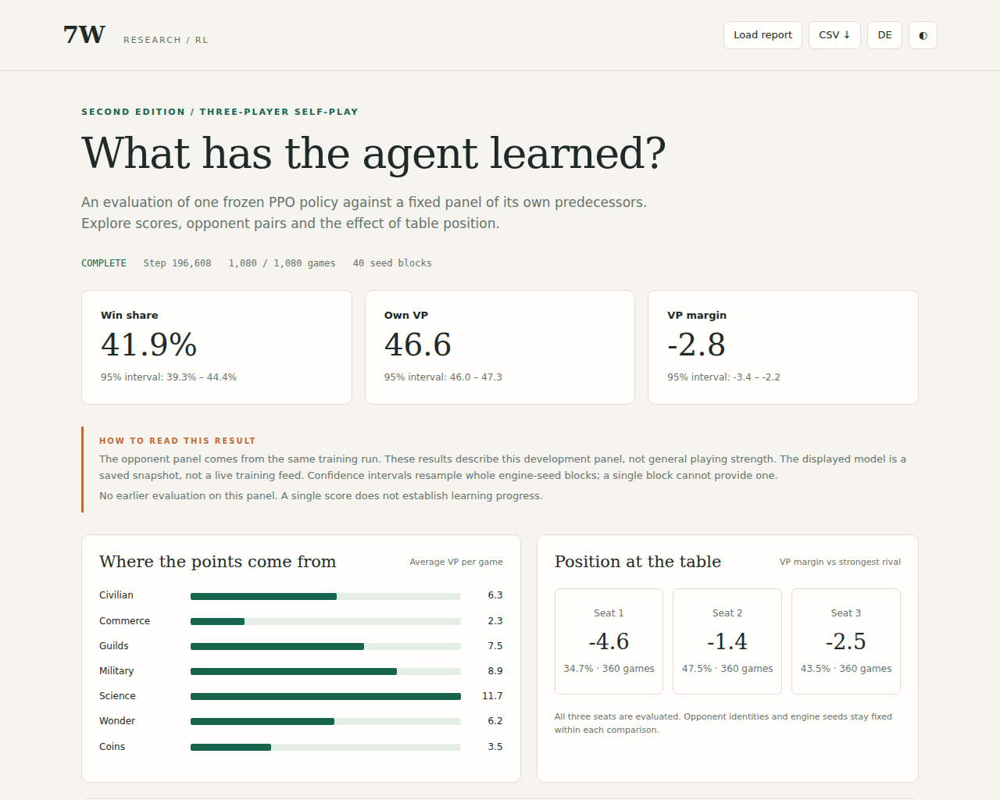
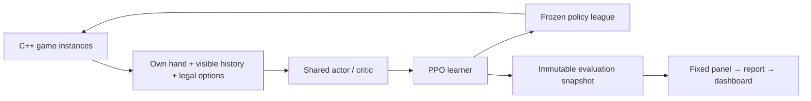

# Seven Wonders RL

**Learning a three-player strategy game from partial information.** A personal
reinforcement learning project built with Python, PyTorch and Gymnasium, using
a separately maintained C++ simulator for **7 Wonders: Second Edition (2020)**.

[**Explore the evaluation dashboard →**](https://martenkrohn.github.io/seven-wonders-rl/)
· [Training](TRAINING.md) · [Method & results](docs/results/README.md) · [Documentation](docs/README.md)

[](https://martenkrohn.github.io/seven-wonders-rl/)

The interesting challenge is planning with hidden information: cards circulate
between players, early choices affect later possibilities, and two opponents
change as the learner improves. This project explores how to represent what an
agent can legitimately know, learn against frozen predecessors and evaluate
progress without confusing a changing opponent pool with a better policy.

## What I built

- A **Gymnasium decision environment** with legal offered options, real follow-up
  choices and no fabricated skipped-turn samples.
- A **shared hand/history representation for actor and critic**: complete own
  hands, public table and ordered visible history; no opponent private hands.
- **PPO with one learner and parallel CPU game collection**, immutable own-policy
  opponents, ordered-pair PFSP-inspired matchmaking and rotating seats.
- **Durable training and resume** with atomic checkpoints, reserved seeds,
  journal repair and clean stop after a complete update.
- **Fixed-panel evaluation and a portable dashboard** with paired comparisons,
  block-bootstrap intervals, score categories, seat/opponent breakdowns and CSV export.

The simulator originates from [DMAG/UFSM](https://github.com/dmag-ufsm/7Wonders).
My maintained [engine fork](https://github.com/martenkrohn/seven-wonders-engine)
provides the Second Edition rules, protocol and GUI; this repository contains
the RL system. [Origin and contribution boundary](docs/ORIGIN.md) distinguish
inherited work from downstream extensions. Development uses coding assistants.

## Current evidence

The public example evaluates the **196,608-decision snapshot** on **1,080 completed
games over 40 engine-seed blocks**, against three frozen same-run policies, all
nine ordered opponent pairs and all three seats:

| Mean own VP | Mean margin to strongest rival | Shared win rate | Failed games |
| --- | --- | --- | --- |
| 46.61 | −2.80 VP | 41.9% | 0 / 1,080 |

This is a development-panel result, **not a general playing-strength claim**.
The dashboard shows uncertainty and provenance. It is a saved evaluation, not the
latest local training state. Historical protocol-2 experiments demonstrated
learning, but their results do not transfer to the new agent. See
[results and limitations](docs/results/README.md).

## Design decisions

**Treat information as a contract.** Both network heads use the same permitted
observations. Known/unknown masks and visible history make memory explicit;
hidden engine state and transport identities never become model inputs.

**Separate learning opponents from evaluation opponents.** The league adapts
using training outcomes. Evaluation keeps opponents, seeds and seats fixed,
retains failures and resamples whole seed blocks for uncertainty estimates.

**Keep experimentation recoverable.** One PPO implementation handles every
worker count. Resume preserves the durable learner and league state while
recording unfinished games as abandoned, rather than manufacturing outcomes.



[Architecture](docs/reference/ARCHITECTURE.md)
and the [observation contract](docs/reference/DECISION_OBSERVATION_CONTRACT.md)
describe the implementation.

## Setup

Tested on **Linux/Ubuntu / WSL, Python 3.12, C++17 and CMake**.

```sh
git clone --recurse-submodules https://github.com/martenkrohn/seven-wonders-rl.git
cd seven-wonders-rl
python3.12 -m venv python/.venv
python/.venv/bin/python -m pip install -c python/constraints.txt -e './engine' -e './python[dev]'
cmake -S . -B build -DCMAKE_BUILD_TYPE=Release
cmake --build build --parallel 2
```

The engine is pinned by commit and protocol in `engine.lock.json`. Tested direct
Python dependency versions are recorded in `python/constraints.txt`.

## Try it

Run a small technical training check in a new output directory:

```sh
python/.venv/bin/python python/scripts/train_decision_ppo.py \
  --steps 128 --workers 4 --output-dir python/runs/smoke
```

For continuous training, clean stop and resume, use [TRAINING.md](TRAINING.md).
Independent evaluation requires three trained reference snapshots (normally
196,608 decisions); [the evaluation guide](docs/guides/EVALUATION.md) explains
the plan and dashboard export. Existing reports can be rendered without
replaying games or loading weights.

Fast checks: `cd python && make test-fast`. Full active-system checks:
`make test-all`. Choose targeted tests for small edits; historical trainers and
legacy engine builds are no longer part of normal validation.

## Next questions

How much does explicit history help at a matched compute budget? Does opponent
selection discover different strategies? Do gains survive independent training
seeds and new opponents? These remain [research questions](docs/research/AGENDA.md).
The current model does not implement recurrent memory, a multiplayer equilibrium
solver or a demonstrated optimal strategy.

## Project layout

```text
engine/                         Pinned standalone engine and client
python/src/sevenwonders_rl/      Environment, memory, PPO, league and evaluation
python/scripts/                 Seven supported operational tools
python/tests/                   Active contracts and recovery checks
docs/                           Current guides, contracts, results and research
demo/                           Deliberately selected public aggregate snapshot
```

Training runs, model weights, generated builds and caches stay local. Historical
code and complete experiment records remain in Git history.

## License

**GPL-3.0-only**, inherited from the simulator and retained for the downstream
RL code. See [LICENSE](LICENSE), [NOTICE](NOTICE) and [origin](docs/ORIGIN.md).
Bundled engine dependencies and assets retain their respective notices.
