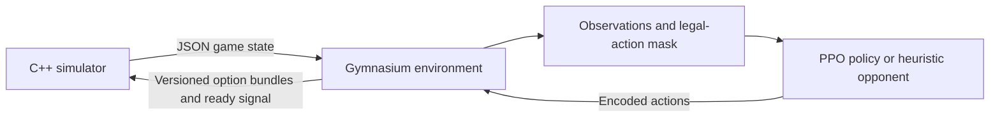

# Seven Wonders RL

A work-in-progress reinforcement-learning project for three-player **7 Wonders**. It adds a Python Gymnasium environment and PyTorch PPO agents to an existing C++ game simulator.

The simulator comes from [DMAG/UFSM's 7Wonders](https://github.com/dmag-ufsm/7Wonders). This project adds the RL environment, observation and action features, heuristic opponents, training/evaluation tools and snapshot self-play. The maintained [engine fork](https://github.com/martenkrohn/seven-wonders-engine) is a separate project, included at a fixed commit under `engine/`. Its legacy releases preserve earlier experiments. The active BGA path uses protocol 3, generated card/wonder data and offered physical-card decisions.

**BGA release:** `v0.2.0-bga`, ruleset `bga-second-edition`, protocol 3.
The [acceptance record](docs/reference/bga-release-validation.json) records the
exact engine pin and local checks. Remote publication still requires approval.
Start new training with the [BGA guide](docs/guides/BGA_RL.md).

**Legacy research stage:** exploratory training has demonstrated learning, including
improved resource preparation in longer runs. The project is now moving toward
targeted, scientifically grounded experiments on exploration, opponent
populations and robust evaluation. Further gains in the latest continuation
remain uncertain. An explicit observation-history extension is implemented;
its playing-strength benefit and the next opponent-selection rule remain open.

Start with the [documentation index](docs/README.md) and the
[research overview](docs/research/OVERVIEW.md). Current guides and technical
references are separated from the [exploratory experiment archive](docs/archive/README.md).
The implementation includes PPO/GAE, optional multiple heads and frozen priors,
public card/wonder information, mixed frozen-opponent pools and milestone
dashboards. The optional [memory mode](docs/guides/OBSERVATION_MEMORY.md) shares
complete own-hand, legal-action and observed-history inputs with actor and critic.
See the [known limitations](docs/reference/KNOWN_ISSUES.md) before
interpreting results as general playing strength.

## How it works



The active `DecisionEnv` starts the engine through the shared standard-library
client and submits versioned bundles of offered options. Every environment step
is an actual learner decision, including mandatory discard choices and eligible
seventh cards. Other seats advance automatically; there are no fabricated steps
for a skipped seventh card. Options are bound to physical card instances,
decision IDs and offered revisions.

The policy receives a seat-relative public table, its own visible candidates,
an option mask and versioned action features. Up to 128 offered options cover
both ordinary hands and the discard pile. Wonder construction describes the
next stage and the foregone hand card separately. Science features optimize
existing jokers. Opponent private hands are absent from observations and info.
The terminal objective is the learner's VP margin against the strongest rival.

`SevenWondersEnv` exported by `sevenwonders_rl.envs` now aliases `DecisionEnv`.
The old 28-action environment, features and research tools remain explicitly
`LegacySevenWondersEnv` / protocol 2. They require the retained legacy engine;
old models and learning curves do not transfer to the new contract.

## What is inherited and what is added

| Component | Origin |
| --- | --- |
| Core C++ simulator and file protocol | DMAG/UFSM's upstream project |
| Most engine source and bundled JSON headers | Preserved from upstream |
| Engine corrections and protocol v2 | Selectable production, trading, Gizah B, final status, seeded RNG and atomic publication |
| BGA data and protocol 3 | Generated definitions, optimal science, simultaneous settlement, explicit special decisions and new GUI |
| Gymnasium wrapper, masks and feature extraction | RL extension in this project |
| PyTorch actor-critic, PPO scripts, opponent policies and self-play pool | RL extension in this project |
| Detailed evaluation, strategy telemetry and interactive HTML dashboard | RL extension in this project |
| Python tests, C++ regression checks and CI setup | Downstream development and validation |

The [origin record](docs/ORIGIN.md) pins the upstream commit. The [simulator change log](docs/SIMULATOR_CHANGES.md) documents each C++ correction, with an exact patch and checked file inventory. This distinguishes inherited implementation from downstream work; it does not claim that every line of the extension was written manually. Development has used coding assistants.

## Setup

The supported development environment is **Linux/Ubuntu, including WSL**. Use Python 3.12, a C++17 compiler and CMake. From the repository root:

```sh
git submodule update --init --recursive
python3.12 -m venv python/.venv
source python/.venv/bin/activate
python -m pip install -e './engine' -e './python[dev]'
cmake -S . -B build
cmake --build build --parallel 2
```

The package declares Python >=3.10; Python 3.12 is the tested baseline. Dependencies include Gymnasium, NumPy and PyTorch. Versions are not locked, so the package declaration is not a fully pinned reproduction environment.

Clone with `git clone --recurse-submodules` or initialize the submodule as above.
See the [engine workflow](docs/guides/ENGINE.md) for separate development and updates.

## Run the checks

From the repository root, with the environment active:

```sh
python python/scripts/check_engine.py
ctest --test-dir build --output-on-failure
cd python
python -m pytest -m 'unit or component'
python -m pytest -m integration
```

Unit/component tests use recorded game-state fixtures. Integration tests require `build/7Wonders`. These checks cover the implemented interfaces and selected rule regressions; they do not establish complete board-game rule correctness or successful learning. See the [validation record](docs/archive/validation/VALIDATION.md) for the checks performed during this cleanup and the [architecture notes](docs/reference/ARCHITECTURE.md) for the environment and training interfaces.

## Active BGA training and evaluation

```sh
python python/scripts/train_decision_ppo.py --steps 256 --eval-games 3 --output-dir python/runs/bga-fresh
python python/scripts/train_decision_ppo.py --steps 256 --resume python/runs/bga-fresh/checkpoint.pt --output-dir python/runs/bga-resume
```

Use `--allow-development` only when deliberately testing an unreleased
BGA development engine. Dataset, ruleset, protocol, action semantics and
feature names are checked before checkpoint loading. Resume restores model,
optimizer and Torch state and starts a fresh engine game; it is not a midgame
restoration. Short tests validate the pipeline, not playing strength.
See [the BGA migration guide](docs/guides/BGA_RL.md).

## Historical training and evaluation

The following entry points preserve protocol-2 research and old experiments.
They require an explicit legacy engine and do not operate the BGA environment.


The main training and evaluation entry points are below. From `python/`:

```sh
python scripts/ppo_training/train_unified.py --help
python scripts/eval_selfplay.py --help
python scripts/build_dashboard.py --help
```

- **Fixed opponents:** `--mode fixed` trains against a mixture of heuristic policies.
- **Neural opponents:** `--mode selfplay` supports fresh initialization or compatible pretrained weights, frozen snapshots and optional configured opponent groups. Ordinary evaluation uses rolling predecessors; milestone mode uses an unchanged panel. The [architecture reference](docs/reference/ARCHITECTURE.md) distinguishes these modes.
- **Training evaluation:** readable console summaries show victory-point sources, score distributions and science participation. Opponent identities are recorded; changing reference opponents are not presented as directly comparable progress measurements.
- **Detailed evaluation:** the separate evaluator compares final and intermediate models on the same opponent, seed and seat plan. Reports include score categories, age-by-age development, card choices relative to legal opportunities, and bootstrap uncertainty intervals over engine-seed blocks. See the [evaluation guide](docs/guides/EVALUATION.md).

Base feature semantics are **version 3**. The optional public-state extension
adds public played-card identities and wonder identities/stage plans. Checkpoints
enforce compatible schemas. The [latest completed long-run assessment](docs/archive/long-training/LONG_TRAINING_V2_RESULTS_2026-10-29.md)
and [earlier fresh-seed comparison](docs/archive/long-training/LONG_FRESH_RESULTS_2026-10-26.md)
describe the current evidence and its limits. Historical runs affected by
incorrect GAE or premature scoring are not evidence for the corrected trainer.
No checkpoints are bundled. The [script index](python/scripts/README.md) lists
main tools, diagnostics and historical experiment wrappers.

## Analysis dashboard

[**Explore the evaluation dashboard →**](https://martenkrohn.github.io/seven-wonders-rl/)

The public example is a historical snapshot of the completed **Seed 31, feature
semantics v3** experiment: 262,144 training transitions, followed by a detailed
evaluation of initial, intermediate and final models against trained predecessors.
It does not represent the latest local model. See its
[assessment](docs/archive/selfplay/SELFPLAY_FEATURE_V3_RESULTS_2026-10-24.md) and the
[snapshot/update guide](docs/guides/DASHBOARD_DEMO.md).

Each detailed evaluation produces a standalone `dashboard.html` that opens directly in a browser, without a server or external dependencies. It provides sortable tables, card search and filters, score distributions, age-by-age summaries, model comparisons and CSV exports. Additional evaluation reports can be loaded locally. English is the default; an English/German selector updates labels, number formatting and CSV exports and remembers a manual choice. Both languages are available locally and in the public demo. Light and dark themes follow the system preference until a manual choice is saved.

Existing evaluation data can be turned into a dashboard without replaying games or loading model weights. From `python/`, replace the example directory with an evaluation directory containing `analysis.json`:

```sh
python scripts/build_dashboard.py --evaluation-dir runs/YOUR-EVALUATION
```

Open `runs/YOUR-EVALUATION/dashboard.html` in your browser. The [evaluation guide](docs/guides/EVALUATION.md#interaktives-dashboard) explains report comparison, available metrics and how missing data are handled. Training logs, checkpoints and routine generated dashboards remain local; only the explicitly selected public demo snapshot is bundled in `demo/`.

## Repository layout

```text
engine/                          Pinned standalone C++ engine (Git submodule)
engine.lock.json                 Engine commit, release, ruleset and protocol
CMakeLists.txt                   Compatibility build: still produces build/7Wonders
python/src/sevenwonders_rl/
  envs/                          Gymnasium wrapper and engine transport
  features/                      Observations, action features and trade estimates
  policies/                      Heuristics and checkpoint-backed opponents
  evaluation/                    Game telemetry, evaluation reports and dashboard
  selfplay/                      Frozen-checkpoint opponent pool
  utils/                         Actor-critic model and PPO utilities
  data/                          Engine-derived card/wonder data and mechanics
python/scripts/ppo_training/     Main training and evaluation tools
python/scripts/eval_selfplay.py  Detailed self-play evaluation and report rendering
python/scripts/build_dashboard.py  Dashboard generation from saved analysis
python/tests/                   Python tests and a selected fixture pool
docs/README.md                   Documentation entry point and current status
docs/research/                   Research agenda, overview and detailed sources
docs/experiments/                Protocols and results for upcoming focused experiments
docs/reference/, docs/guides/    Technical contracts and operational instructions
docs/archive/                    Exploratory protocols, results and measurement summaries
```

Generated builds, runtime exchange files, logs, training runs and checkpoints are ignored. The original GUI, its artwork and unrelated reference archives are not distributed in this source tree.

## License and attribution

This project is distributed under **GNU GPL version 3**; see [LICENSE](LICENSE) and [NOTICE](NOTICE). The inherited GPLv3 license is retained and also applies to the downstream RL code and simulator modifications. The vendored **nlohmann/json** library retains its MIT license and copyright notices.
