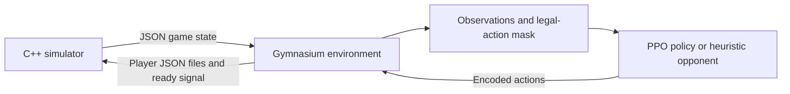

# Seven Wonders RL

A work-in-progress reinforcement-learning project for three-player **7 Wonders**. It adds a Python Gymnasium environment and PyTorch PPO agents to an existing C++ game simulator.

The simulator comes from [DMAG/UFSM's 7Wonders](https://github.com/dmag-ufsm/7Wonders). This project adds the RL environment, observation and action features, heuristic opponents, training/evaluation tools and snapshot self-play. It also includes a few targeted simulator fixes; it does not implement the original game engine from scratch.

**Current stage:** self-play training has demonstrated learning in the tested setting, with gains over untrained policies and trained predecessors on separate evaluation seeds. Detailed evaluation also revealed limited strategic diversity. The next development focus is long-term strategy discovery and the classic **deep exploration** challenge: trying sequences of decisions whose benefits only emerge later.

Neural-only self-play, corrected PPO/GAE, rolling trained evaluation opponents and a local analysis dashboard are implemented. RAM exchange and grouped opponent inference support longer runs. See the [experiment guide](docs/SELFPLAY_POC.md), [moderate-run results](docs/SELFPLAY_MODERATE_RESULTS_2026-10-23.md), [feature corrections](docs/FEATURE_CORRECTIONS_2026-10-23.md), [validation record](docs/VALIDATION.md) and [remaining limitations](docs/KNOWN_ISSUES.md). These results establish a proof of concept, not a general playing-strength benchmark.

## How it works



Python starts the simulator, reads its state and submits actions for all three seats. The learner controls one seat; the other two use heuristic policies or frozen policy snapshots. Communication is currently file-based: `game_status.json`, `player_1.json` through `player_3.json`, and `ready.txt`.

The environment exposes 28 action slots: four action types for each of seven hand positions. These cover building a structure, building a wonder stage, using a free-build action and discarding. Masks restrict the available choices. Observation builders rotate player information relative to the learner and provide global state and per-action features. The terminal reward compares the learner's victory points with the strongest opponent, scaled by the training configuration.

## What is inherited and what is added

| Component | Origin |
| --- | --- |
| Core C++ simulator and file protocol | DMAG/UFSM's upstream project |
| Most engine source and bundled JSON headers | Preserved from upstream |
| Engine corrections and protocol v2 | Selectable production, trading, Gizah B, final status, seeded RNG and atomic publication |
| Gymnasium wrapper, masks and feature extraction | RL extension in this project |
| PyTorch actor-critic, PPO scripts, opponent policies and self-play pool | RL extension in this project |
| Detailed evaluation, strategy telemetry and interactive HTML dashboard | RL extension in this project |
| Python tests, C++ regression checks and CI setup | Downstream development and validation |

The [origin record](docs/ORIGIN.md) pins the upstream commit. The [simulator change log](docs/SIMULATOR_CHANGES.md) documents each C++ correction, with an exact patch and checked file inventory. This distinguishes inherited implementation from downstream work; it does not claim that every line of the extension was written manually. Development has used coding assistants.

## Setup

The supported development environment is **Linux/Ubuntu, including WSL**. Use Python 3.12, a C++17 compiler and CMake. From the repository root:

```sh
python3.12 -m venv python/.venv
source python/.venv/bin/activate
python -m pip install -e './python[dev]'
cmake -S . -B build
cmake --build build --parallel 2
```

The package declares Python >=3.10; Python 3.12 is the tested baseline. Dependencies include Gymnasium, NumPy and PyTorch. Versions are not locked, so the package declaration is not a fully pinned reproduction environment.

## Run the checks

From the repository root, with the environment active:

```sh
ctest --test-dir build --output-on-failure
cd python
python -m pytest -m 'unit or component'
python -m pytest -m integration
```

Unit/component tests use recorded game-state fixtures. Integration tests require `build/7Wonders`. These checks cover the implemented interfaces and selected rule regressions; they do not establish complete board-game rule correctness or successful learning. See the [validation record](docs/VALIDATION.md) for the checks performed during this cleanup and the [architecture notes](docs/ARCHITECTURE.md) for the environment and training interfaces.

## Training and evaluation

The main training and evaluation entry points are below. From `python/`:

```sh
python scripts/ppo_training/train_unified.py --help
python scripts/eval_selfplay.py --help
python scripts/build_dashboard.py --help
```

- **Fixed opponents:** `--mode fixed` trains against a mixture of heuristic policies.
- **Neural-only self-play:** `--mode selfplay` starts against its random initial neural checkpoint, trains against frozen same-run snapshots and evaluates against rolling trained predecessors. See the [proof-of-concept guide](docs/SELFPLAY_POC.md) for pilots, separate holdout evaluation and a moderate training budget.
- **Training evaluation:** readable console summaries show victory-point sources, score distributions and science participation. Opponent identities are recorded; changing reference opponents are not presented as directly comparable progress measurements.
- **Detailed evaluation:** the separate evaluator compares final and intermediate models on the same opponent, seed and seat plan. Reports include score categories, age-by-age development, card choices relative to legal opportunities, and bootstrap uncertainty intervals over engine-seed blocks. See the [evaluation guide](docs/EVALUATION.md).

Current feature semantics are **version 3**: science symbols and jokers, building chains, trade discounts and production features have been corrected. New training runs require fresh output directories and compatible checkpoints. The [latest assessment](docs/SELFPLAY_FEATURE_V3_RESULTS_2026-10-24.md) evaluates a completed run with these corrections; the earlier moderate-run results predate them. This is not a controlled comparison isolating the effect of the corrections. Earlier exploratory results affected by incorrect GAE or premature scoring are separate from the corrected proof-of-concept runs. No checkpoints are bundled. The [script index](python/scripts/README.md) separates the main tools from diagnostics and older trainers.

## Analysis dashboard

[**Explore the evaluation dashboard →**](https://martenkrohn.github.io/seven-wonders-rl/)

The public example contains the completed **Seed 31, feature semantics v3** experiment: 262,144 training transitions, followed by a detailed evaluation of the initial, intermediate and final models against trained predecessors on a shared test plan. See the [latest assessment](docs/SELFPLAY_FEATURE_V3_RESULTS_2026-10-24.md) for findings and the [snapshot and update guide](docs/DASHBOARD_DEMO.md) for how the example is replaced as new results become available.

Each detailed evaluation produces a standalone `dashboard.html` that opens directly in a browser, without a server or external dependencies. It provides sortable tables, card search and filters, score distributions, age-by-age summaries, model comparisons and CSV exports. Additional evaluation reports can be loaded locally. English is the default; an English/German selector updates labels, number formatting and CSV exports and remembers a manual choice. Both languages are available locally and in the public demo. Light and dark themes follow the system preference until a manual choice is saved.

Existing evaluation data can be turned into a dashboard without replaying games or loading model weights. From `python/`, replace the example directory with an evaluation directory containing `analysis.json`:

```sh
python scripts/build_dashboard.py --evaluation-dir runs/YOUR-EVALUATION
```

Open `runs/YOUR-EVALUATION/dashboard.html` in your browser. The [evaluation guide](docs/EVALUATION.md#interaktives-dashboard) explains report comparison, available metrics and how missing data are handled. Training logs, checkpoints and routine generated dashboards remain local; only the explicitly selected public demo snapshot is bundled in `demo/`.

## Repository layout

```text
main.cpp, src/, include/          C++ simulator and vendored JSON headers
tests/                           C++ regression checks
python/src/sevenwonders_rl/
  envs/                          Gymnasium wrapper and engine transport
  features/                      Observations, action features and trade estimates
  policies/                      Heuristics and checkpoint-backed opponents
  evaluation/                    Game telemetry, evaluation reports and dashboard
  selfplay/                      Frozen-checkpoint opponent pool
  utils/                         Actor-critic model and PPO utilities
  data/                          Engine-derived card/wonder data and mechanics
python/scripts/ppo_training/     Main training and evaluation tools
python/scripts/eval_selfplay.py  Detailed self-play evaluation and report rendering
python/scripts/build_dashboard.py  Dashboard generation from saved analysis
python/tests/                   Python tests and a selected fixture pool
docs/                            Origin, architecture and known issues
```

Generated builds, runtime exchange files, logs, training runs and checkpoints are ignored. The original GUI, its artwork and unrelated reference archives are not distributed in this source tree.

## License and attribution

This project is distributed under **GNU GPL version 3**; see [LICENSE](LICENSE) and [NOTICE](NOTICE). The inherited GPLv3 license is retained and also applies to the downstream RL code and simulator modifications. The vendored **nlohmann/json** library retains its MIT license and copyright notices.
